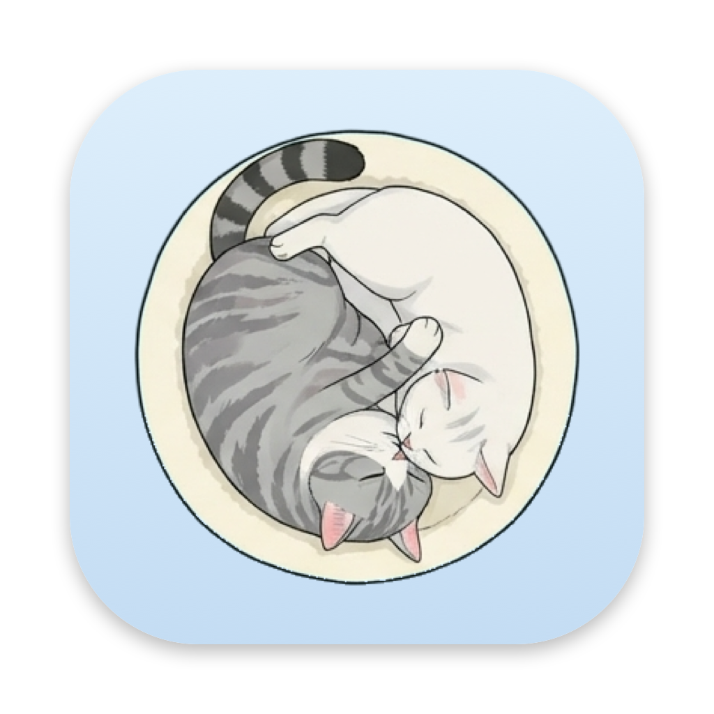

# 谷谷和团团 · Mac 桌面宠物

两只真实存在的猫——胖胖的美短**谷谷**和小白猫**团团**——住进你的 Mac 桌面。

## 下载就能用

1. 打开右边的 **[Releases](../../releases/latest)**，下载 `GuguTuantuan-Pets.zip`（显示名「谷谷和团团（下载这个）」）
2. 双击解压，把 **谷谷和团团.app** 拖进「应用程序」文件夹（不拖也能用）
3. **第一次打开**：右键点 App →「打开」→ 再点「打开」
   - 如果提示「无法验证开发者」：打开「系统设置 → 隐私与安全性」，在下方找到这个 App，点「仍要打开」
   - 只需要这一次，以后双击就能打开

不需要安装任何其他东西。支持 macOS 13 及以上，Apple 芯片和 Intel 都可以。

> 为什么会有第 3 步：这个 App 没有付费购买苹果的开发者签名，所以 macOS 第一次会问你一下。App 不联网、不收集任何数据。

## 玩法

| 操作 | 效果 |
|---|---|
| 单击 | 谷谷打哈欠 / 翻肚皮 / 敲电脑，团团站起来扒 / 洗脸 / 翻肚皮 / 敲电脑 |
| 左右拖动 | 朝拖的方向走 |
| 往上提 / 按住不动 | 被拎起来的样子 |
| 拖到半空松手 | 掉回屏幕底部，落地轻轻弹一下（可在 ⚙️ 设置里关掉） |
| 一会儿不理它们 | 会睡着，两只靠得近会一起睡；叫醒时先伸个懒腰 |
| 每天第一次打开 | 两只一起伸懒腰说早上好 |
| 偶尔 | 自己散步、一起吃饭、一起趴着 |
| 你在打字 | 它们轮流敲电脑（每 15 秒换一只），你停它们也停；可在 ⚙️ 设置里关掉。只看“多久前按过键”，不记录按了什么 |

右键猫咪，或点菜单栏的 🐾 打开菜单。

**位置**（菜单 → ⚙️ 设置 → 位置）：
- **总在最前**：任何窗口都挡不住它们
- **不置顶**：待在桌面上，会被窗口盖住
- **藏在角落睡觉**：Dock 右边有空地就缩小了窝在那里睡；没空地就躲到所有窗口后面睡

## 小工具

- **📝 待办**：菜单里打开待办小窗口，勾选完成、× 删除
- **✏️ 记一笔（⌥ + 空格）**：随时弹出输入框，回车就记下
  - 写上时间会到点提醒：`15:00 交报表`、`3点半 开会`、`下午4点 取快递`、`10分钟后 关火`、`2小时后 喝水`
  - 到点后猫会跳起来，头上冒出提醒气泡
- **📋 剪贴板历史**：最近复制的 10 条文字，点一下就重新复制。只保存在内存里，退出就清空；密码管理器复制的密码不会被记录
- **🤫 自动安静**：全屏看视频、放 PPT，或打开 Zoom / Teams / 腾讯会议 / FaceTime 时，两只猫会缩到角落睡觉，结束后自动醒来（设置里可以关）

## 自己编译

需要 Xcode 命令行工具（`xcode-select --install`）：

```bash
bash app/build.sh
```

- `app/Sources/main.swift`：全部程序，只用系统自带的 AppKit
- `app/manifest.json`：每个动作用哪些帧、播放多久
- `frames/`：抠好的透明帧图（AI 按真猫照片生成后整理）
- `tools/`：整理帧图用的小工具（切图、抠背景等）
